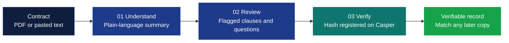
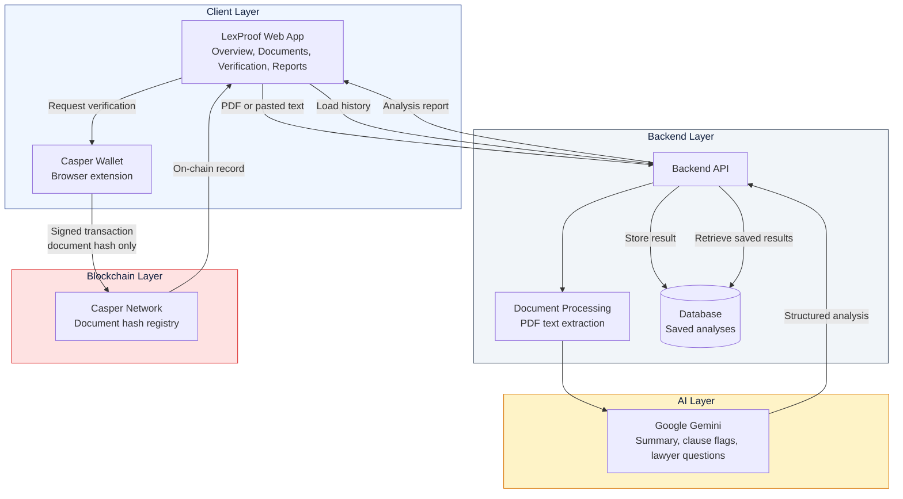
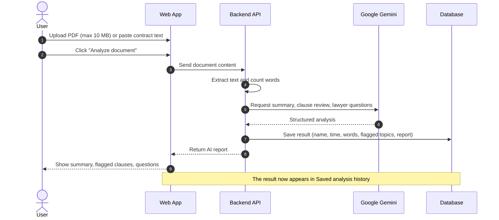
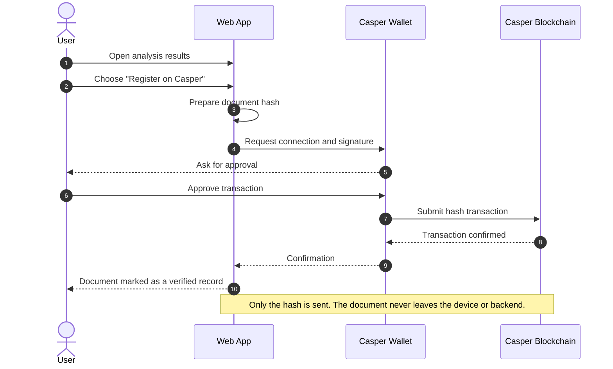
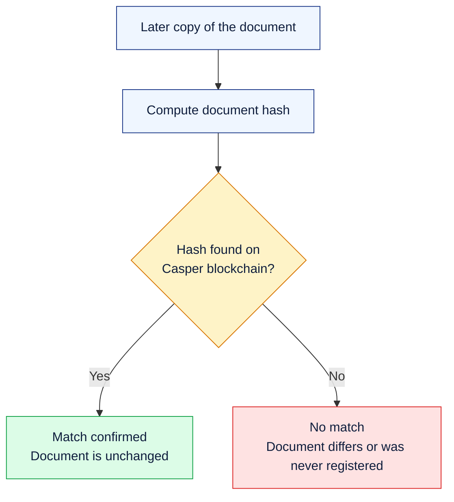
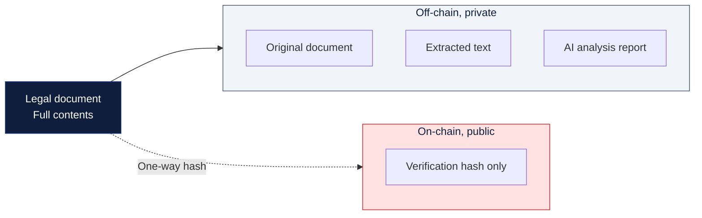
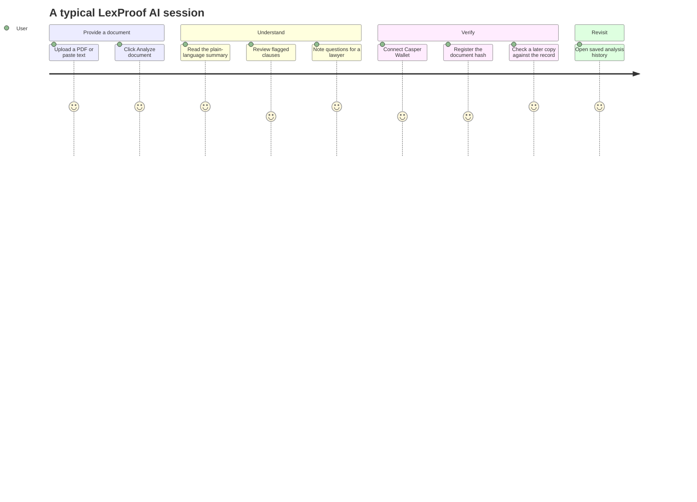

 

### Clarity for every contract.

**AI-powered legal document intelligence with blockchain-backed integrity verification.**

 

---

## Table of Contents

- [Overview](#overview)
- [The Problem](#the-problem)
- [Our Solution](#our-solution)
- [Key Features](#key-features)
- [How LexProof Works](#how-lexproof-works)
- [System Architecture](#system-architecture)
- [Workflow Diagrams](#workflow-diagrams)
  - [Document Analysis Flow](#document-analysis-flow)
  - [Blockchain Verification Flow](#blockchain-verification-flow)
  - [Integrity Check Flow](#integrity-check-flow)
  - [Privacy by Design](#privacy-by-design)
  - [User Journey](#user-journey)
- [Application Walkthrough](#application-walkthrough)
- [Tech Stack](#tech-stack)
- [Privacy and Security](#privacy-and-security)
- [Roadmap](#roadmap)
- [Disclaimer](#disclaimer)
- [Contributing](#contributing)
- [License](#license)

---

## Overview

**LexProof AI** is a legal intelligence platform that helps people understand contracts and prove that a document has not been altered.

It combines two technologies:

1. **Generative AI (Google Gemini)** turns dense legal language into plain-language summaries, highlights clauses that deserve a closer look, and suggests questions to raise with a lawyer.
2. **Casper blockchain** stores a cryptographic **hash** of a document as a tamper-proof record. The document itself never leaves your control.

> LexProof AI · Legal intelligence, with transparency.

---

## The Problem

- Contracts are long, complex, and written in language most people do not use day to day.
- Important clauses are easy to miss, and a missed clause can be costly.
- Once a document is shared, it is hard to prove later that a copy is identical to the original.
- Putting legal documents on a public blockchain would expose sensitive information.

## Our Solution

LexProof AI separates **understanding** from **verification**:

| Need | How LexProof addresses it |
|---|---|
| Understand a contract | Gemini generates a plain-language summary and flags clauses worth reviewing |
| Know what to ask | Potential concerns and questions to discuss with a lawyer |
| Prove integrity | A document hash is registered on the Casper blockchain |
| Keep data private | Documents stay off-chain, and only the hash is registered |

---

## Key Features

- **PDF upload**: select a PDF of up to 10 MB directly from your computer.
- **Paste contract text**: analyze a clause or a full agreement by pasting it in.
- **AI-powered analysis**: summaries and clause highlights generated by a connected Gemini AI backend.
- **Flagged topics**: potentially concerning clauses are surfaced for closer review.
- **Questions for your lawyer**: suggested points to discuss with a legal professional.
- **Saved analysis history**: past results are stored in a database and can be reopened at any time.
- **Keyword scan fallback**: a lightweight keyword-based scan is recorded when a full AI report is not produced.
- **Blockchain verification**: register a document hash on the Casper blockchain.
- **Casper Wallet integration**: connect your wallet to register verification records.
- **Dashboard metrics**: documents in the current session, saved analyses, and verified on-chain records.
- **Privacy by design**: documents stay off-chain.

---

## How LexProof Works

A clear path from contract to verifiable record.

| Step | Stage | Description |
|:---:|---|---|
| **01** | **Understand** | Generate a plain-language summary and highlight clauses that may need review. |
| **02** | **Review** | Explore potential concerns and questions to discuss with a lawyer. |
| **03** | **Verify** | Register a document hash on-chain to check whether a later copy matches. |

---

## System Architecture

LexProof AI is made up of a web client, a backend API, an AI engine, a database for saved analyses, and the Casper blockchain for verification.

### Components

| Component | Responsibility |
|---|---|
| **Web App** | Document upload, text input, results display, history, wallet connection |
| **Backend API** | Orchestrates analysis requests, talks to Gemini, reads and writes saved results |
| **Document Processing** | Extracts readable text from uploaded PDFs |
| **Google Gemini** | Generates summaries, highlights clauses, and suggests questions for review |
| **Database** | Persists analysis history (file name, timestamp, word count, flagged topics, report) |
| **Casper Wallet** | Lets the user sign and submit verification transactions |
| **Casper Network** | Immutable registry of document hashes |

---

## Workflow Diagrams

### Document Analysis Flow

What happens when a user clicks **Analyze document**.

### Blockchain Verification Flow

How a document hash is registered on Casper.

### Integrity Check Flow

How a later copy is compared against the on-chain record.

> Even a one-character change in the document produces a completely different hash, which is what makes tamper detection reliable.

### Privacy by Design

What stays off-chain and what goes on-chain.

### User Journey

---

## Application Walkthrough

### Workspace navigation

| Section | Purpose |
|---|---|
| **Overview** | Dashboard with session stats, document analysis, and saved history |
| **Documents** | Manage documents you have analyzed |
| **Blockchain Verification** | Register and review document hashes on Casper |
| **Reports** | Access generated analysis reports |

### Dashboard metrics

| Metric | Meaning |
|---|---|
| **Documents selected** | Documents chosen in the current session |
| **Saved analyses** | Analyses retrieved from the database |
| **Verified records** | Documents registered on the Casper blockchain |

### Analyzing a document

1. **Upload a PDF** (up to 10 MB) or **paste contract text**.
2. Click **Analyze document**.
3. Read the AI report: summary, flagged topics, and questions to discuss with a lawyer.
4. Optionally **register the document hash** on the Casper blockchain from the results screen.

### Saved analysis history

Every analysis is saved and listed with:

- Document name (or *Pasted text*)
- Report type (**AI report ready** or **Keyword scan**)
- Date and time
- Word count
- Number of topics flagged
- A **View saved result** action to reopen it

Use **Refresh history** to pull the latest results from the backend.

---

## Tech Stack

| Layer | Technology |
|---|---|
| **AI** | Google Gemini |
| **Blockchain** | Casper Network |
| **Wallet** | Casper Wallet |
| **Backend** | API service connected to Gemini and a database |
| **Storage** | Database for saved analyses (documents are not placed on-chain) |
| **Frontend** | Web application with a responsive dashboard UI |

---

## Privacy and Security

- **Documents stay off-chain.** Only verification hashes are registered on the blockchain.
- **Hashes are one-way.** A hash proves a document's integrity but cannot be reversed to reveal its contents.
- **Wallet-controlled signing.** Blockchain transactions are approved by the user in Casper Wallet.
- **Demo warning.** This is a prototype, so please **do not upload sensitive or confidential documents**.

---

## Roadmap

- [x] PDF upload and pasted-text analysis
- [x] Gemini-powered summaries and clause review
- [x] Saved analysis history
- [x] Casper Wallet connection
- [x] Document hash registration on Casper
- [ ] Upload a later copy and verify it against an on-chain record
- [ ] Exportable PDF analysis reports
- [ ] Side-by-side clause comparison between document versions
- [ ] Multi-language contract support
- [ ] Production-grade access control and encryption

---

## Disclaimer

**LexProof AI is a prototype and does not provide legal advice.**

AI-generated summaries and flagged clauses are informational only and may be incomplete or inaccurate. Always consult a qualified lawyer before making legal decisions or signing any agreement.

---

## Contributing

Contributions, ideas, and feedback are welcome.

1. Fork the repository
2. Create a feature branch: `git checkout -b feature/your-feature`
3. Commit your changes: `git commit -m "Add your feature"`
4. Push to the branch: `git push origin feature/your-feature`
5. Open a Pull Request

---

## License

This project is released under the **MIT License**. See the `LICENSE` file for details.

---

**LexProof AI** · Legal intelligence, with transparency.

*Prototype · Not legal advice*

